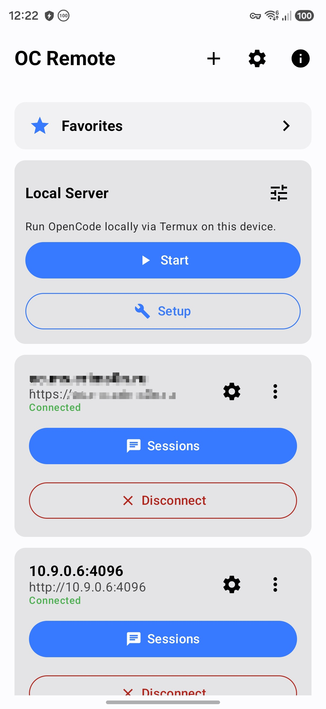
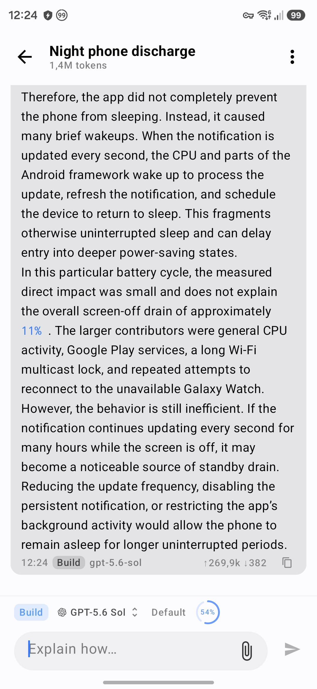
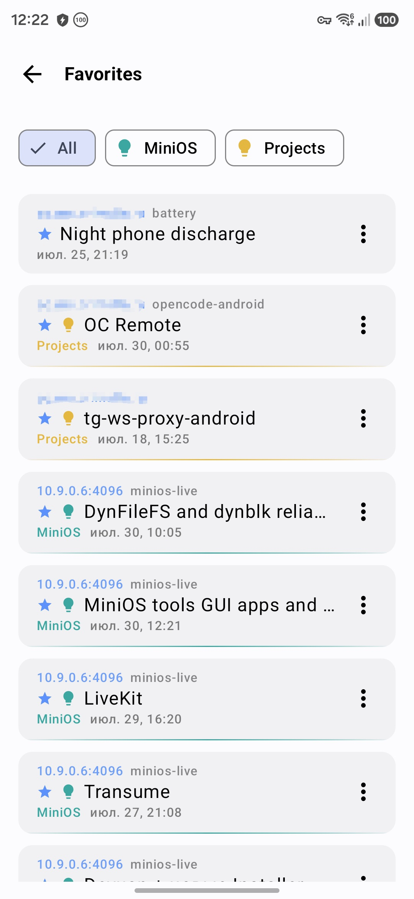
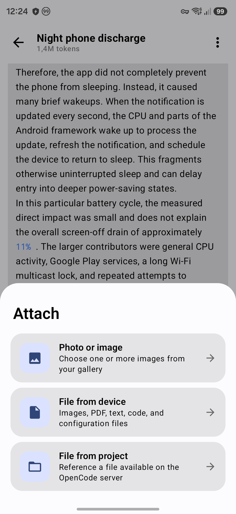
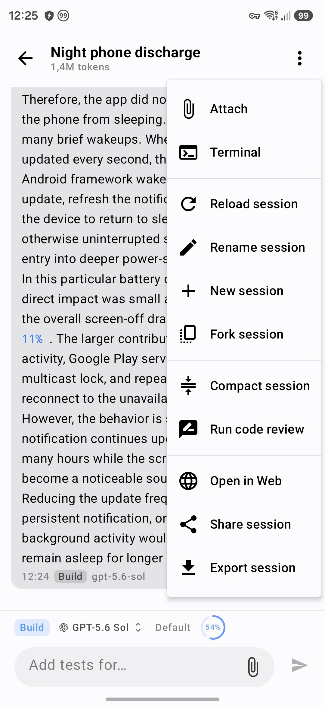
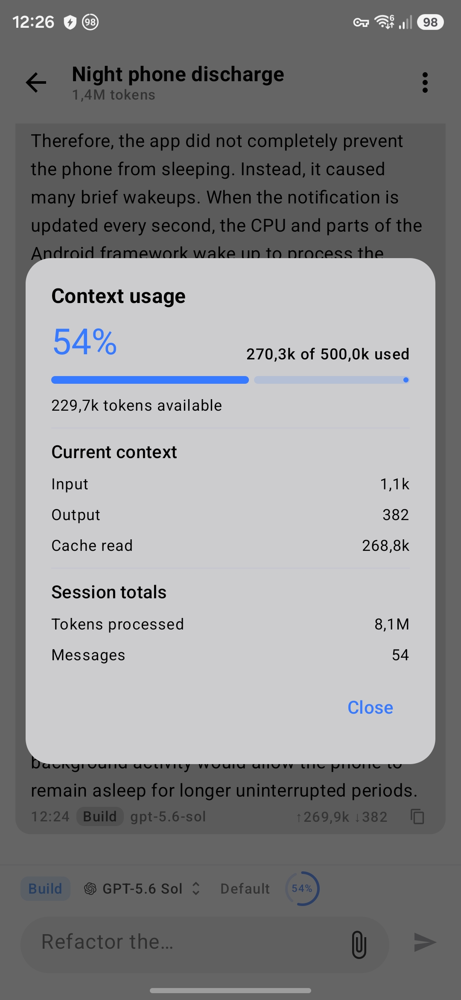
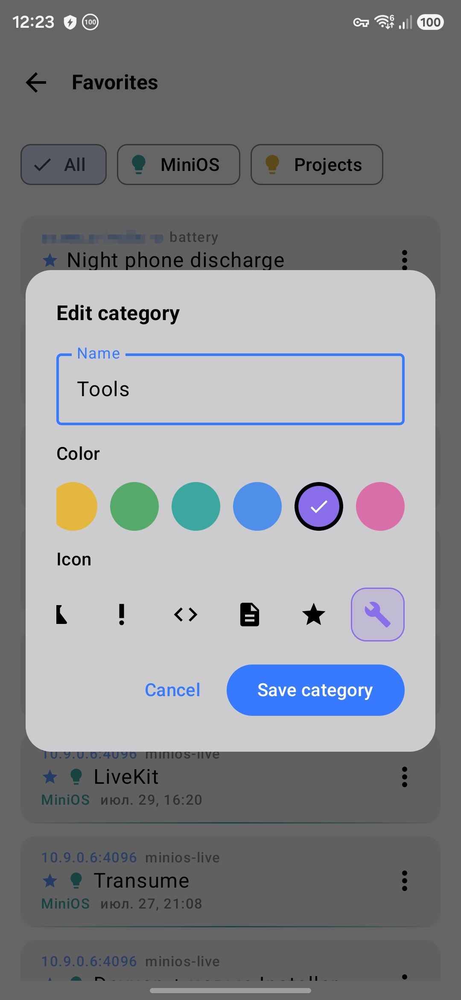
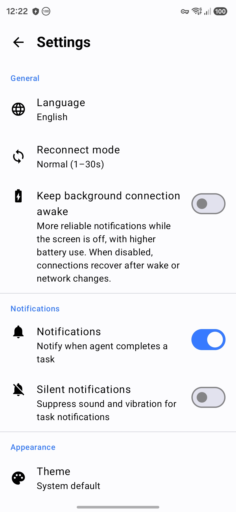
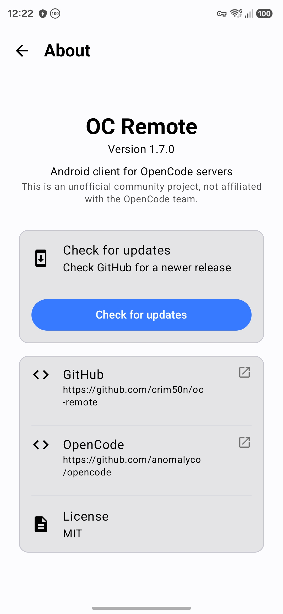

<div align="center">


# OC Remote

### Your coding agent. Wherever you are.

A native Android companion for [OpenCode](https://github.com/anomalyco/opencode).<br />
Chat with your agent, explore your workspace, and open a real terminal from your phone.

<p>
  <a href="https://github.com/crim50n/oc-remote/releases/latest"></a>
  <a href="#get-started"></a>
  <a href="https://github.com/crim50n/oc-remote/actions/workflows/release.yml"></a>
  <a href="#make-it-yours"></a>
  <a href="LICENSE"></a>
</p>

<p>
  <a href="https://github.com/crim50n/oc-remote/releases/latest"></a>
  <a href="#get-started"></a>
  <a href="https://github.com/crim50n/oc-remote/issues"></a>
</p>

[Screenshots](#screenshots) · [Features](#features) · [Compatibility](#compatibility) · [Build](#build-from-source)

<sub>Unofficial community project. Not affiliated with the OpenCode team.</sub>

</div>

---

## Built for Mobile Work

| **Pick up the conversation** | **Stay close to your workspace** | **Keep control** |
| :--- | :--- | :--- |
| Native streaming chat, model and agent selection, attachments, and readable tool results. | Browse files, preview changes, switch projects, and work in a full interactive terminal. | Answer questions, approve permissions, stop runs, and reconnect without losing your place. |

Connect to your own remote servers, or run OpenCode on-device through **Termux**. Manage multiple connections and keep important sessions together in **Favorites**.

## Screenshots

<p align="center"><sub>Real app screens. Select an image to view it at full resolution. Appearance may vary by version and theme.</sub></p>

<table>
  <tr>
    <th width="33%">01 / Your servers</th>
    <th width="33%">02 / Native chat</th>
    <th width="33%">03 / Favorites</th>
  </tr>
  <tr>
    <td align="center"><a href="screenshots/01_home_and_servers.jpg"></a></td>
    <td align="center"><a href="screenshots/03_chat.jpg"></a></td>
    <td align="center"><a href="screenshots/02_favorites.jpg"></a></td>
  </tr>
  <tr>
    <td align="center"><sub>Remote connections and local runtime</sub></td>
    <td align="center"><sub>Your agent, without the desktop</sub></td>
    <td align="center"><sub>Important sessions, one place</sub></td>
  </tr>
</table>

<details>
<summary><strong>Explore six more screens: attachments, session actions, context, and settings</strong></summary>
<br />

<table>
  <tr>
    <th width="33%">Bring your files</th>
    <th width="33%">Act on a session</th>
    <th width="33%">Understand context</th>
  </tr>
  <tr>
    <td align="center"><a href="screenshots/04_attachments.jpg"></a></td>
    <td align="center"><a href="screenshots/05_session_actions.jpg"></a></td>
    <td align="center"><a href="screenshots/06_context_usage.jpg"></a></td>
  </tr>
  <tr>
    <td align="center"><sub>Images, documents, and project files</sub></td>
    <td align="center"><sub>Review, fork, export, and more</sub></td>
    <td align="center"><sub>Tokens, cache, and remaining capacity</sub></td>
  </tr>
  <tr>
    <th>Organize your sessions</th>
    <th>Make it yours</th>
    <th>Stay up to date</th>
  </tr>
  <tr>
    <td align="center"><a href="screenshots/07_category_editor.jpg"></a></td>
    <td align="center"><a href="screenshots/08_settings.jpg"></a></td>
    <td align="center"><a href="screenshots/09_about_updates.jpg"></a></td>
  </tr>
  <tr>
    <td align="center"><sub>Reusable categories and 32 icon choices</sub></td>
    <td align="center"><sub>Appearance and behavior, your way</sub></td>
    <td align="center"><sub>Verified updates inside the app</sub></td>
  </tr>
</table>

</details>

## Get Started

**You need:** Android **8.0+** and an OpenCode server reachable from your phone.

### 1. Install the app

[Download the latest APK](https://github.com/crim50n/oc-remote/releases/latest) from GitHub Releases and open it on your Android device. If prompted, allow installation from the browser or file manager you used.

Future updates can be checked from **About**. In-app downloads are verified against their SHA-256, package/version, and signing certificate before Android's installer opens.

### 2. Start your server

On the computer hosting your project:

```bash
opencode serve --port 4096 --hostname 0.0.0.0
```

> [!IMPORTANT]
> `0.0.0.0` listens on all network interfaces. Use a trusted network or VPN, configure authentication, and do not expose an unauthenticated server to the public internet. Use HTTPS when connecting over an untrusted network.

### 3. Connect and work

Open OC Remote, tap **+**, and enter your server URL, for example `http://192.168.0.10:4096`, along with the server's username and password if configured. Tap **Connect**, then **Sessions**.

Prefer to work entirely on your phone? The **Local OpenCode** card guides you through setup and launch using Termux.

## Features

### Chat, Files, and Context

- **Native Material 3 chat:** streaming responses, GFM Markdown, syntax-highlighted code, tables, copy actions, and scroll behavior that respects manual scrolling.
- **Reading mode:** translucent, blurred chat panels hide as you scroll toward newer messages and return on reverse scrolling or Back. Session activity remains visible, with optional hiding of Android system bars.
- **Useful tool cards:** expandable results, selectable shell output, diffs, and a headers-only mode to reduce rendering memory.
- **Files within reach:** open file links from chat, browse folders in a list or three-column grid, search filenames, and preview text, Markdown, images, PDFs, and static HTML. Back from a chat file link returns to chat; folder navigation stays within the project.
- **File transfers:** download, open, and share files, including large APKs on compatible V1 servers. V2 adds streamed uploads and text editing; available actions depend on the server API.
- **Attachments and Android sharing:** send images, PDFs, text, source code, and configuration files from your device or another app.
- **Model and agent controls:** searchable model picker, provider icons, variants, model visibility, and agent selection.
- **Context visibility:** token breakdowns, cache usage, remaining context capacity, and session cost.
- **Human-in-the-loop actions:** ordered permission and question prompts, retry controls, and Stop for active runs.

### A Real Terminal

Open an interactive **PTY terminal over WebSocket** without leaving the session.

| Input | Navigation | Recovery |
| :--- | :--- | :--- |
| Dedicated extra keys, Ctrl/Alt latching, volume-key modifiers, and `Ctrl+Alt+V` paste | Server-scoped terminal tabs, inertial scrollback, pinch zoom, and text selection | Viewport/keyboard-aware resizing, connection status, reconnect, and restart for exited tabs |

### Projects and Sessions

- **Multiple servers:** connect simultaneously, reorder remote cards, and cancel pending connections.
- **Project organization:** search and group sessions, revisit recent directories, and handle Windows and Unicode project paths.
- **Cross-server Favorites:** reorder sessions, filter by custom categories, and keep offline favorites visible.
- **Session tabs:** switch between saved open sessions across servers, search and reorder tabs, undo closing, and reconnect when opening a disconnected server's tab.
- **Session actions:** fork, compact, review, rename, revert, delete, and export JSON; sharing is available where supported by the server API.
- **Fast history:** show the newest 10 messages first, load the configured history target in the background, and fetch older pages on demand.
- **Draft persistence:** preserve text, attachments, and confirmed file mentions across navigation and app restarts.
- **Read-only subagents:** inspect child-session history and context without unsafe prompt controls.

### Make It Yours

| Appearance | Interaction | Connections |
| :--- | :--- | :--- |
| Light, dark, system, and true-black AMOLED themes | Adjustable chat and terminal fonts, code wrapping, and compact messages | Reconnect policies, background WakeLock, and keep-screen-on controls |
| Material You dynamic colors on Android 12+ | Configurable haptic duration/amplitude and a test action | Completion notifications with optional silent delivery |
| **15 languages** | Reasoning expansion, turn dividers, and send confirmation | Local runtime authentication, LAN binding, proxy, and startup settings |

Favorites, categories, and session tabs can each be disabled without deleting saved data. Power-related controls are grouped together in Settings. Toggle image compression from the session menu; resolution and quality remain in Settings. AMOLED uses black panels, file tiles, menus, and notification surfaces with contrasting borders.

<details>
<summary><strong>All supported languages</strong></summary>

English · Russian · German · Spanish · French · Italian · Portuguese (Brazil) · Indonesian · Japanese · Korean · Chinese (Simplified) · Ukrainian · Turkish · Arabic · Polish

Translations are maintained with [Lokit](https://github.com/crim50n/oc-remote/blob/master/lokit.yaml).

</details>

### Sync and Reliability

**Settings sync** works through GitHub Gist, WebDAV, or an Android document provider. Preferences, ordered remote servers, categories, assignments, Favorites, and hidden models travel together. Independent changes merge automatically; overlapping changes offer local/remote choices that retain unrelated edits.

Server passwords are optional and encrypted with a separate passphrase. Sync credentials and local-runtime configuration remain device-specific.

**Offline-aware screens** retain cached content in read-only mode and show connection status. History processing uses response limits and disk-backed handling; diagnostics provide privacy-sanitized logs with export controls. Provider authentication and MCP management are available according to server capabilities.

## Compatibility

OC Remote detects **OpenCode V1 or V2 per connection**.

| Server API | Availability |
| :--- | :--- |
| **V1** | Existing native chat, terminal, session, and server-management workflows |
| **V2** | Initial integration based on `@opencode/cli` **2.0.30**, with filesystem support updated against **2.1.4** |

> [!NOTE]
> OC Remote does not implement V2 configuration writes or native MCP OAuth; V1-style session sharing is unavailable on V2. Unsupported forms offer a web-client fallback. End-to-end V2 device verification is still pending; automated tests do not establish full live-server compatibility.

[Known issues](KNOWN_ISSUES.md) · [Release history](https://github.com/crim50n/oc-remote/releases)

## Build from Source

Use **JDK 17** and the Android SDK, or open the project in **Android Studio**, sync Gradle, and run on a device or emulator.

```bash
# Build the development APK
./gradlew assembleDebug

# Install on a connected device
adb install -r app/build/outputs/apk/debug/app-debug.apk

# Run unit tests and Android lint
./gradlew :app:test :app:lint
```

## Feedback and Contributions

Found a bug? [Open an issue](https://github.com/crim50n/oc-remote/issues/new) with your OC Remote version, OpenCode version, Android version, and reproduction steps. Attach a sanitized diagnostic export when possible; never include passwords or API tokens.

Have an improvement in mind? [Browse open pull requests](https://github.com/crim50n/oc-remote/pulls) to avoid duplicate work, keep changes focused, and include tests for behavior changes.

---

<div align="center">

**OC Remote** · Native Android access to your OpenCode servers

[Download](https://github.com/crim50n/oc-remote/releases/latest) · [Report a bug](https://github.com/crim50n/oc-remote/issues) · [Back to top](#oc-remote)

<sub>Source code: <a href="LICENSE">MIT License</a>. The OC Remote name, logo, and app icon are subject to the <a href="TRADEMARKS.md">trademark and branding policy</a>; forks must use a distinct identity.</sub>

</div>
